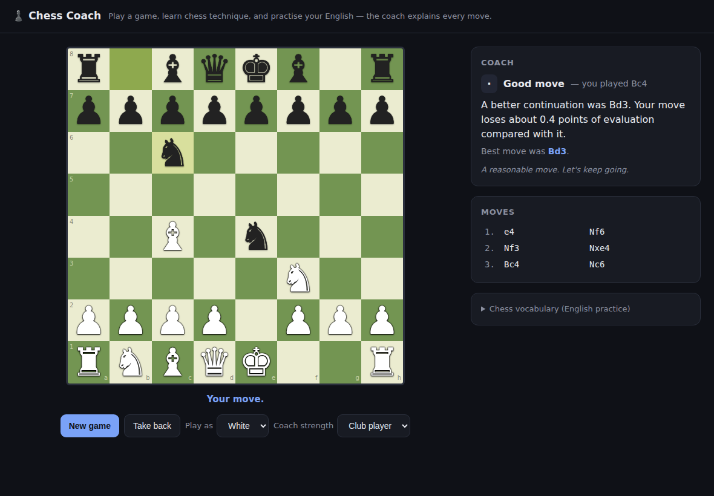

# ♟️ Chess Coach — aprende ajedrez y practica inglés a la vez

Un juego de ajedrez completo donde un **entrenador profesional** te explica, en
**inglés**, cada jugada: si fue la mejor y, sobre todo, *por qué* o *por qué no*,
usando técnica de ajedrez real (desarrollo, centro, piezas colgadas, táctica…).

La idea: juegas una partida y, en cada movimiento tuyo, el entrenador compara tu
jugada con la mejor del motor y te escribe una explicación corta en inglés. Así
practicas inglés leyendo vocabulario de ajedrez real.

## Cómo abrirlo

**Opción A — sin nada instalado (lo más fácil):**
abre el archivo `index.html` en tu navegador (doble clic), o usa
`ABRIR_AJEDREZ.bat` en la carpeta principal. Todo el ajedrez corre en
JavaScript dentro del navegador: **no necesita Ollama ni Flask.**

**Opción B — desde el servidor Flask del proyecto:**
ejecuta `python web.py` y entra en <http://127.0.0.1:5000/ajedrez>.

## Qué hace el entrenador

- Clasifica tu jugada: **Best move / Great / Good / Inaccuracy / Mistake / Blunder**.
- Detecta si **cuelgas material** (una pieza sin defender) y te dice con qué
  jugada te la ganan y cuántos puntos pierdes.
- Te recuerda **principios de apertura**: desarrollar piezas, luchar por el
  centro, enrocar pronto, no sacar la dama demasiado temprano.
- Te sugiere la **mejor jugada** cuando la tuya no lo era.
- Incluye un **glosario de vocabulario** de ajedrez en inglés para estudiar.

Puedes elegir jugar con blancas o negras y la fuerza del entrenador
(*Beginner / Club player / Strong* = profundidad de búsqueda 2 / 3 / 4).

## Cómo está hecho (por dentro)

Tres archivos de JavaScript, sin dependencias ni librerías externas:

| Archivo | Qué es |
|---|---|
| [`engine.js`](engine.js) | El motor de ajedrez: tablero, generación de **jugadas legales**, jaque/mate/tablas, enroque, al paso, coronación. Verificado con *perft* (`perft(4) = 197281`, exacto). |
| [`coach.js`](coach.js) | El "cerebro": evaluación con tablas de posición, búsqueda **negamax con poda alfa-beta** (sirve de rival y de analista), **SEE** (static exchange evaluation) para detectar piezas colgadas, y el generador de explicaciones en inglés. |
| [`app.js`](app.js) | La interfaz: dibuja el tablero, gestiona los clics, pide al entrenador que revise tu jugada y deja que el rival responda. |

El mismo patrón que el resto del repo — *un bucle + un evaluador + una condición
de parada* — pero aplicado a ajedrez en lugar de a un agente de código.
